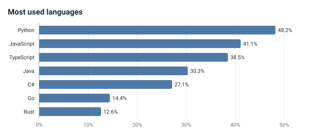
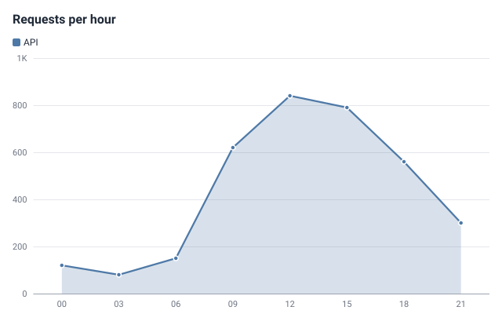
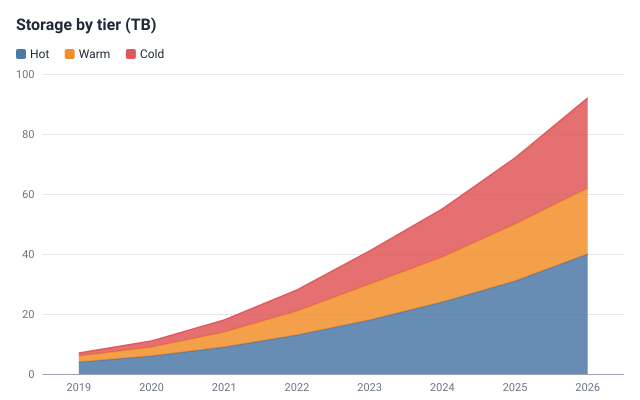
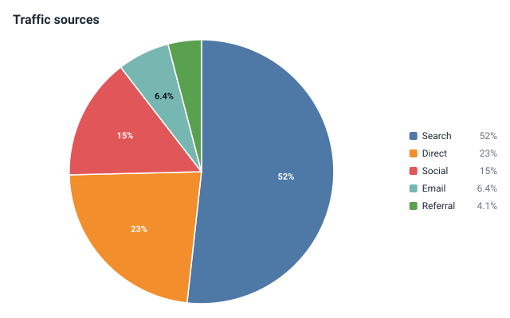
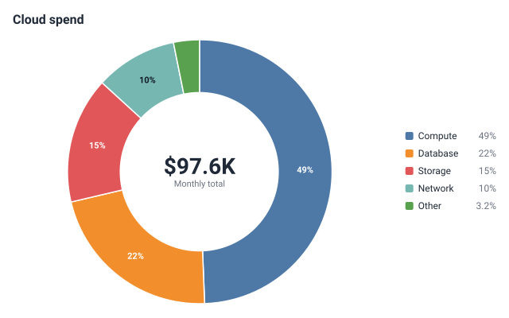
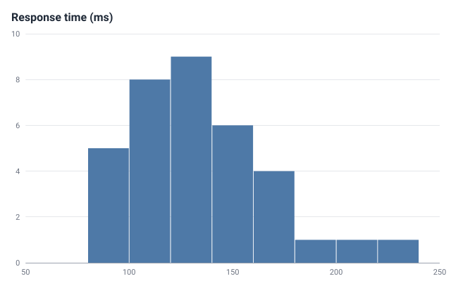
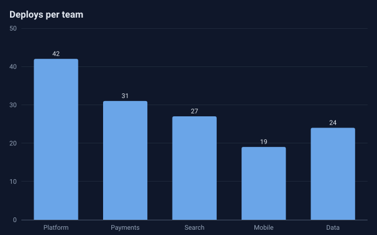

# agent-tools

Ready-made tools for AI agents. Instead of having a model generate an SVG, a chart
script or a document token by token, the agent writes a short spec and a deterministic
tool does the rest. The output is the same every time, and the model spends about
20 times fewer tokens.

Each tool is a product in this catalog. The first one is a chart builder.

| tool | what it does |
|---|---|
| [`chart`](src/agent_tools/chart/USAGE.md) | bar, hbar, line, area, scatter, pie, donut, histogram from JSON to SVG or PNG |

## Install

```sh
pip install "git+https://github.com/ankit22sharma/agent-tools"
# PNG output: also install cairosvg, or have rsvg-convert on PATH
pip install "agent-tools[png] @ git+https://github.com/ankit22sharma/agent-tools"
```

No runtime dependencies. Python 3.10+.

## Chart builder

```sh
agent-tools chart '{"type":"bar","title":"Revenue by region","data":{"North":1240000,"South":905000,"East":1530000,"West":712000},"prefix":"$"}' -o revenue.png
# prints: revenue.png
```


The CLI prints only the output path, so the result costs the agent a few tokens.
Errors are one line on stderr that say what to fix, with exit code 2.

From Python:

```python
from agent_tools.chart import render, save
svg = render({"type": "donut", "data": {"Compute": 48, "Storage": 15}})
save({"type": "line", "x": ["Q1", "Q2"], "series": {"Web": [3, 5]}}, "out.png")
```

### Gallery

| | | |
|---|---|---|
|  |  |  |
|  |  |  |
|  |  |  |
|  |  |  |

Specs for every chart above are in [`examples/specs.json`](examples/specs.json).

### What it handles for you

- Round axis ticks and compact numbers (`$1.5M`, `40K`, `12%`).
- Labels that fit: long category names are rotated or shortened, crowded axes skip labels.
- Pie slices beyond 8 are grouped into "Other". Slice labels pick black or white text for contrast.
- Gaps in line data (`null`) break the line instead of dropping to zero.
- Light and dark themes, colorblind-friendly default palette, accessible `<title>`.
- Small output: each example SVG is 2 to 4 KB with no scripts or external fonts.

### Token cost

Estimated as characters / 4. "SVG tokens" is what a model would write to produce the
same chart by hand. Run `python scripts/build_examples.py` to reproduce.

| chart | spec tokens | SVG tokens | saved |
|---|---:|---:|---:|
| bar | 37 | 553 | 94% |
| bar-stacked | 41 | 882 | 96% |
| line | 49 | 896 | 95% |
| scatter | 52 | 885 | 95% |
| pie | 29 | 586 | 96% |
| donut | 42 | 668 | 94% |
| histogram | 48 | 552 | 92% |

Writing matplotlib code instead usually takes 150 to 400 tokens of code, plus a heavy
install and a second round trip when the code fails.

## Using it from an agent

Copy [`AGENTS.md`](AGENTS.md) into your agent's instructions, or let the agent run
`agent-tools docs chart` when it needs the spec format (about 200 tokens). A CLI keeps
the cost at zero until the tool is used. An MCP server would put its tool schema into
context on every turn, so it is not the default here.

## Adding a tool

Each tool lives in `src/agent_tools/<name>/` with a `USAGE.md` of 300 tokens or less,
a CLI subcommand, an entry in `CATALOG`, examples and tests. Tools must be
deterministic, dependency-free where possible, and print short output.

## License

MIT
