<p>
  <picture>
    <source media="(prefers-color-scheme: dark)" srcset="docs/brand/wordmark-on-dark.svg">
    
  </picture>
</p>

[](https://github.com/jigstore/jigstore/actions/workflows/ci.yml)
[](LICENSE)
[](https://github.com/sponsors/ankit22sharma)
[](https://buymeacoffee.com/ankit22sharma)

Ready-made tools for AI agents. In a workshop, a jig lets you repeat a precise job every
time without redoing the setup. Jigstore does the same for agents: instead of having a
model generate an SVG, a chart script or a document token by token, the agent writes a
short spec and a deterministic tool does the rest. The output is the same every time,
the model writes about 20 times fewer tokens, and the result arrives in under a second
instead of 5 to 30 seconds of streaming.

Each tool is a jig in this catalog. The first one is a chart builder.

| jig | what it does |
|---|---|
| [`chart`](src/jigstore/chart/USAGE.md) | 12 chart types (bar, line, area, scatter, pie, donut, histogram, waterfall, funnel, heatmap, sparkline) from JSON to SVG or PNG |
| [`table`](src/jigstore/table/USAGE.md) | Rows, or a CSV/JSON file, to Markdown, SVG, PNG, HTML or CSV, with totals, formats, sorting and in-cell bars and sparklines |

## Install

```sh
pip install "git+https://github.com/jigstore/jigstore"
# PNG output: also install cairosvg, or have rsvg-convert on PATH
pip install "jigstore[png] @ git+https://github.com/jigstore/jigstore"
```

No runtime dependencies. Python 3.10+.

## Chart builder

```sh
jigstore chart '{"type":"bar","title":"Revenue by region","data":{"North":1240000,"South":905000,"East":1530000,"West":712000},"prefix":"$"}' -o revenue.png
# prints: revenue.png
```

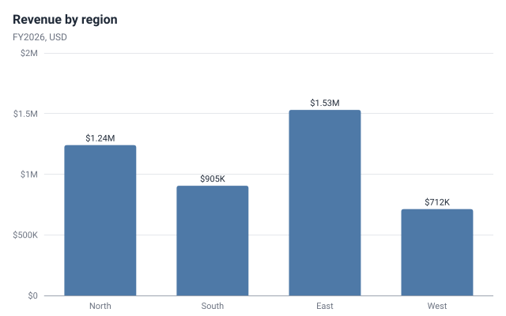

The CLI prints only the output path, so the result costs the agent a few tokens.
Errors are one line on stderr that say what to fix, with exit code 2.

From Python:

```python
from jigstore.chart import render, save

svg = render({"type": "donut", "data": {"Compute": 48, "Storage": 15}})
save({"type": "line", "x": ["Q1", "Q2"], "series": {"Web": [3, 5]}}, "out.png")
```

### Gallery

| | | |
|---|---|---|
| 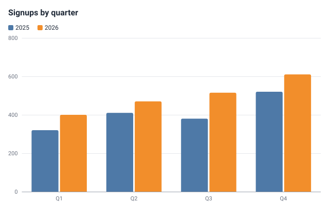 |  |  |
| 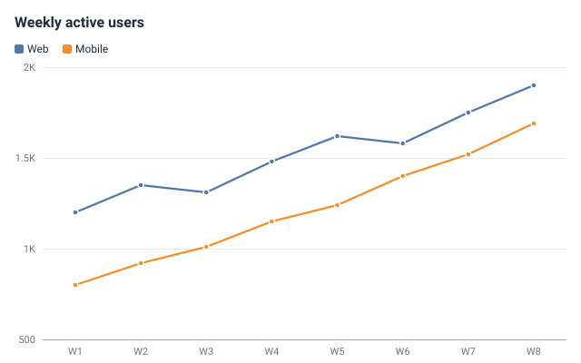 |  |  |
| 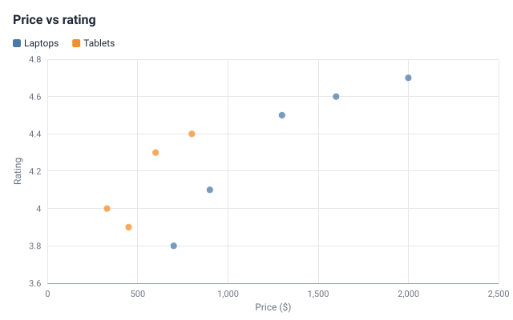 |  |  |
|  |  | 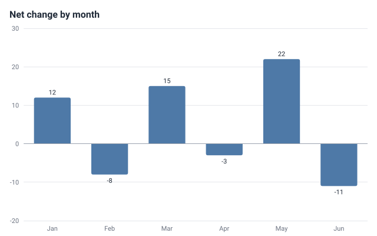 |
| 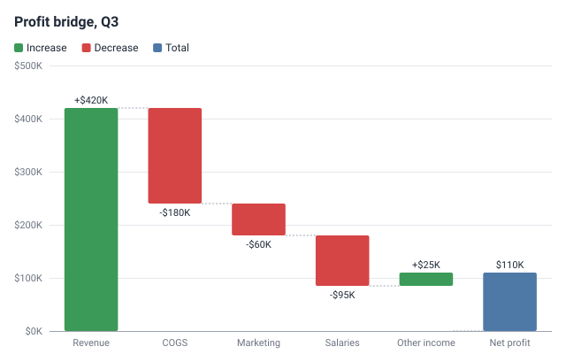 | 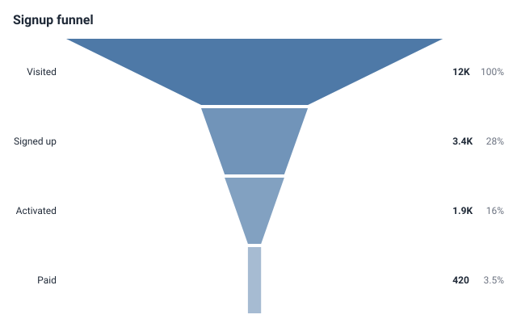 | 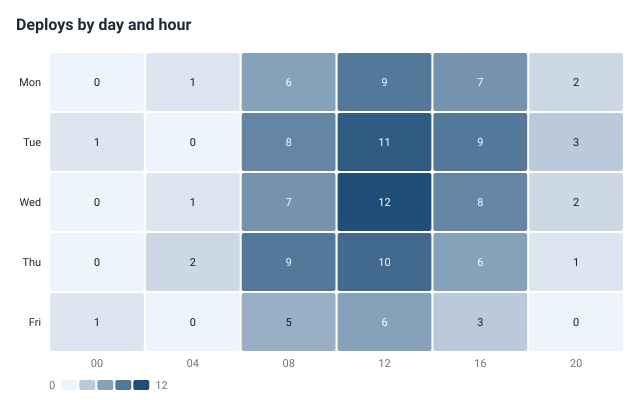 |
| 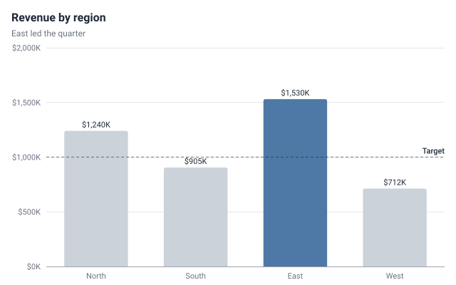 | 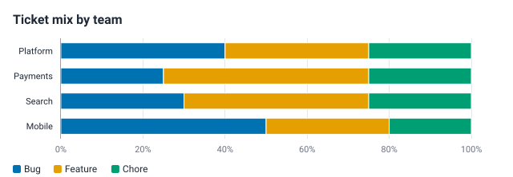 | 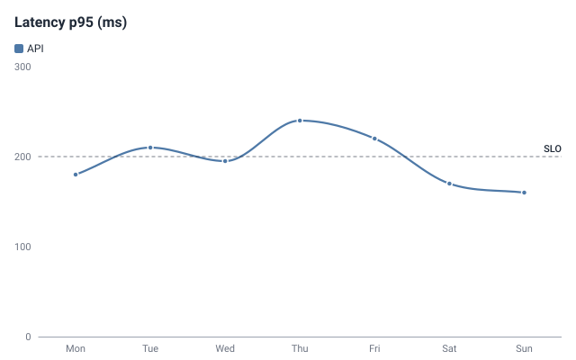 |

Sparkline, for tables and text: 

Specs for every chart above are in [`examples/specs.json`](examples/specs.json).

### Options that tell a story

| Option | Example | What it does |
|---|---|---|
| `highlight` | `"highlight": "East"` | Keeps one category in color and greys out the rest |
| `refs` | `"refs": [{"value": 1000, "label": "Target"}]` | Dashed reference line with a label |
| `stack` | `"stack": "percent"` | 100% stacked bars or areas |
| `curve` | `"curve": "smooth"` or `"step"` | Smooth lines that never overshoot the data, or steps |
| `ymin`, `ymax` | `"ymin": 0` | Fix the value axis |
| `legend` | `"legend": "bottom"` | `top`, `bottom` or `none` |
| `palette` | `"palette": "colorblind"` | `default`, `colorblind` (Okabe-Ito), `mono`, `warm`, `cool` |
| `decimals`, `grid`, `font` | `"decimals": 1, "grid": false` | Number format, gridlines, font family |

### What it handles for you

- Round axis ticks and compact numbers (`$1.5M`, `40K`, `12%`).
- Labels that fit: long category names are rotated or shortened, crowded axes skip labels.
- Pie slices beyond 8 are grouped into "Other". Slice and cell labels pick black or white text for contrast.
- Gaps in line data (`null`) break the line instead of dropping to zero.
- Light and dark themes, colorblind-friendly palettes, accessible `<title>`.
- Small output: most example SVGs are 2 to 4 KB with no scripts or external fonts.
- Safe with untrusted specs: text is escaped and colors are validated. See [SECURITY.md](SECURITY.md).

### Tokens and time

Tokens are estimated as characters / 4. "By hand" is what a model would write to produce
the same chart itself. Time assumes 50 to 100 output tokens a second; rendering takes
about 0.1 ms and is left out. Run `python scripts/build_examples.py` to reproduce.

| chart | spec tokens | SVG by hand | saved | time by hand | time with a spec |
|---|---:|---:|---:|---:|---:|
| bar | 37 | 553 | 94% | 5.5 to 11 s | 0.4 to 0.7 s |
| line | 49 | 896 | 95% | 9 to 18 s | 0.5 to 1 s |
| waterfall | 44 | 827 | 95% | 8.3 to 17 s | 0.4 to 0.9 s |
| heatmap | 50 | 1,586 | 97% | 16 to 32 s | 0.5 to 1 s |
| pie | 29 | 586 | 96% | 5.9 to 12 s | 0.3 to 0.6 s |

Writing matplotlib code instead usually takes 150 to 400 tokens of code, plus a heavy
install and a second round trip when the code fails.

## Table jig

```sh
jigstore table '{"from":"q3.csv","total":{"Region":"Total","Revenue":"sum"}}'   # prints Markdown
jigstore table @spec.json -o q3.png                                              # or .svg .html .csv .md
```

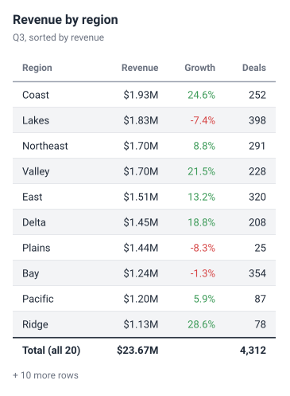 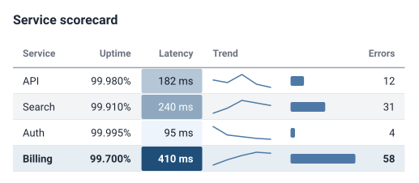

Why an agent would use it rather than write a Markdown table itself:

- **It reads the data from a file.** `"from": "q3.csv"` (or `.json`) means the agent never
  retypes rows it already saved from a query: 17 tokens instead of about 200 for a 20-row
  table, and no copying mistakes. Only the CLI and the local MCP server read files, and
  only inside the working folder (or `JIGSTORE_OUT_DIR`).
- **Numbers come out right.** Totals, averages, sorting and rounding are computed, not guessed.
  Each column uses one unit (`$0.91M`, `$1.24M`) so values line up.
- **It renders where Markdown doesn't.** Slack and most email clients don't show Markdown
  tables. PNG and inline-styled HTML do. Writing that HTML by hand costs 750 to 2,350
  tokens in the examples; the spec costs 78 to 111.
- **Safe output.** Text is escaped in every format, and CSV cells that start with `=`, `+`,
  `-` or `@` are neutralised so spreadsheets don't run them as formulas.

Percentages are written as whole or decimal numbers (`12`, `95.5`) and shown with 2 decimals
unless `decimals` says otherwise. Images show 25 rows by default (`max_rows` up to 200);
Markdown, HTML and CSV keep up to 1,000.

## Using it from an agent

**Shell access (cheapest).** Copy [`docs/agent-prompt.md`](docs/agent-prompt.md) into your agent's instructions,
or let the agent run `jigstore docs chart` or `jigstore docs table` when it needs the
spec format (about 250 tokens each). Nothing is loaded into context until it's used.

**MCP.** Add the server to any MCP client (Claude, Kiro, Cursor, VS Code and others):

```json
{
  "mcpServers": {
    "jigstore": {
      "command": "uvx",
      "args": ["--from", "git+https://github.com/jigstore/jigstore", "jigstore", "mcp"],
      "env": { "JIGSTORE_OUT_DIR": "/path/to/charts" }
    }
  }
}
```

The server exposes one `jig` tool for every jig, so its schema stays about 145 tokens
per turn however many jigs exist. The full spec format of a jig is returned only when a
call fails, so it costs nothing while the model gets specs right. Arguments: `jig`
(`chart` or `table`), `spec`, `out` (a file path whose extension picks the format), and
`view: true` to also get a PNG back so the model can check the result. A table with no
`out` comes back as Markdown text. When `JIGSTORE_OUT_DIR` is set, files are read and
written only inside it.

The server has no dependencies and supports both the 2026-07-28 stateless MCP protocol
and the older `initialize` handshake (2024-11-05 to 2025-11-25).

## Adding a tool

Each tool lives in `src/jigstore/<name>/` with a `USAGE.md` of 300 tokens or less,
a CLI subcommand, an entry in `CATALOG` and in `JIGS` in `mcp.py`, examples and tests.
See [CONTRIBUTING.md](CONTRIBUTING.md).

## Support the project

Jigstore is built and maintained by one person. If it saves your agents tokens, you can
[sponsor it on GitHub](https://github.com/sponsors/ankit22sharma) or
[buy me a coffee](https://buymeacoffee.com/ankit22sharma). Bug reports, tool ideas and pull
requests help just as much.

## License

MIT
