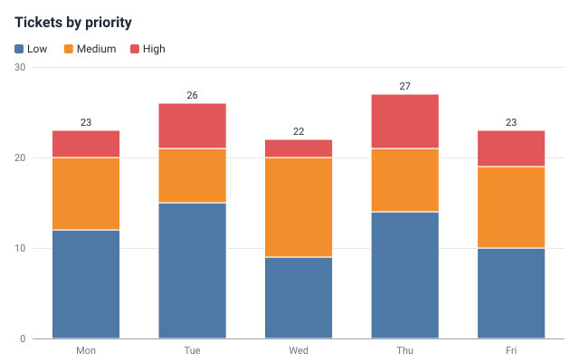

# Jigstore

[](https://github.com/ankit22sharma/jigstore/actions/workflows/ci.yml)
[](LICENSE)

Ready-made tools for AI agents. In a workshop, a jig lets you repeat a precise job every
time without redoing the setup. Jigstore does the same for agents: instead of having a
model generate an SVG, a chart script or a document token by token, the agent writes a
short spec and a deterministic tool does the rest. The output is the same every time,
and the model spends about 20 times fewer tokens.

Each tool is a jig in this catalog. The first one is a chart builder.

| jig | what it does |
|---|---|
| [`chart`](src/jigstore/chart/USAGE.md) | bar, hbar, line, area, scatter, pie, donut, histogram from JSON to SVG or PNG |

## Install

```sh
pip install "git+https://github.com/ankit22sharma/jigstore"
# PNG output: also install cairosvg, or have rsvg-convert on PATH
pip install "jigstore[png] @ git+https://github.com/ankit22sharma/jigstore"
```

No runtime dependencies. Python 3.10+.

## Chart builder

```sh
jigstore chart '{"type":"bar","title":"Revenue by region","data":{"North":1240000,"South":905000,"East":1530000,"West":712000},"prefix":"$"}' -o revenue.png
# prints: revenue.png
```


The CLI prints only the output path, so the result costs the agent a few tokens.
Errors are one line on stderr that say what to fix, with exit code 2.

From Python:

```python
from jigstore.chart import render, save

svg = render({"type": "donut", "data": {"Compute": 48, "Storage": 15}})
save({"type": "line", "x": ["Q1", "Q2"], "series": {"Web": [3, 5]}}, "out.png")
```

### Gallery

| | | |
|---|---|---|
|  |  |  |
|  |  |  |
|  |  |  |
|  |  |  |

Specs for every chart above are in [`examples/specs.json`](examples/specs.json).

### What it handles for you

- Round axis ticks and compact numbers (`$1.5M`, `40K`, `12%`).
- Labels that fit: long category names are rotated or shortened, crowded axes skip labels.
- Pie slices beyond 8 are grouped into "Other". Slice labels pick black or white text for contrast.
- Gaps in line data (`null`) break the line instead of dropping to zero.
- Light and dark themes, colorblind-friendly default palette, accessible `<title>`.
- Small output: each example SVG is 2 to 4 KB with no scripts or external fonts.

### Token cost

Estimated as characters / 4. "SVG tokens" is what a model would write to produce the
same chart by hand. Run `python scripts/build_examples.py` to reproduce.

| chart | spec tokens | SVG tokens | saved |
|---|---:|---:|---:|
| bar | 37 | 553 | 94% |
| bar-stacked | 41 | 882 | 96% |
| line | 49 | 896 | 95% |
| scatter | 52 | 885 | 95% |
| pie | 29 | 586 | 96% |
| donut | 42 | 668 | 94% |
| histogram | 48 | 552 | 92% |

Writing matplotlib code instead usually takes 150 to 400 tokens of code, plus a heavy
install and a second round trip when the code fails.

## Using it from an agent

**Shell access (cheapest).** Copy [`AGENTS.md`](AGENTS.md) into your agent's instructions,
or let the agent run `jigstore docs chart` when it needs the spec format (about
200 tokens). Nothing is loaded into context until the tool is used.

**MCP.** Add the server to any MCP client (Claude, Kiro, Cursor, VS Code and others):

```json
{
  "mcpServers": {
    "jigstore": {
      "command": "uvx",
      "args": ["--from", "git+https://github.com/ankit22sharma/jigstore", "jigstore", "mcp"],
      "env": { "JIGSTORE_OUT_DIR": "/path/to/charts" }
    }
  }
}
```

The server exposes one `chart` tool. Its schema is about 130 tokens, which the client
sends with every turn. The full spec format is returned only when a call fails, so it
costs nothing while the model gets specs right. Arguments: `spec` (required), `out`
(a `.svg` or `.png` path), and `view: true` to also get a PNG back so the model can
check the result. When `JIGSTORE_OUT_DIR` is set, files can only be written inside it.

The server has no dependencies and supports both the 2026-07-28 stateless MCP protocol
and the older `initialize` handshake (2024-11-05 to 2025-11-25).

## Adding a tool

Each tool lives in `src/jigstore/<name>/` with a `USAGE.md` of 300 tokens or less,
a CLI subcommand, an entry in `CATALOG` and the MCP tool list, examples and tests.
See [CONTRIBUTING.md](CONTRIBUTING.md).

## License

MIT
